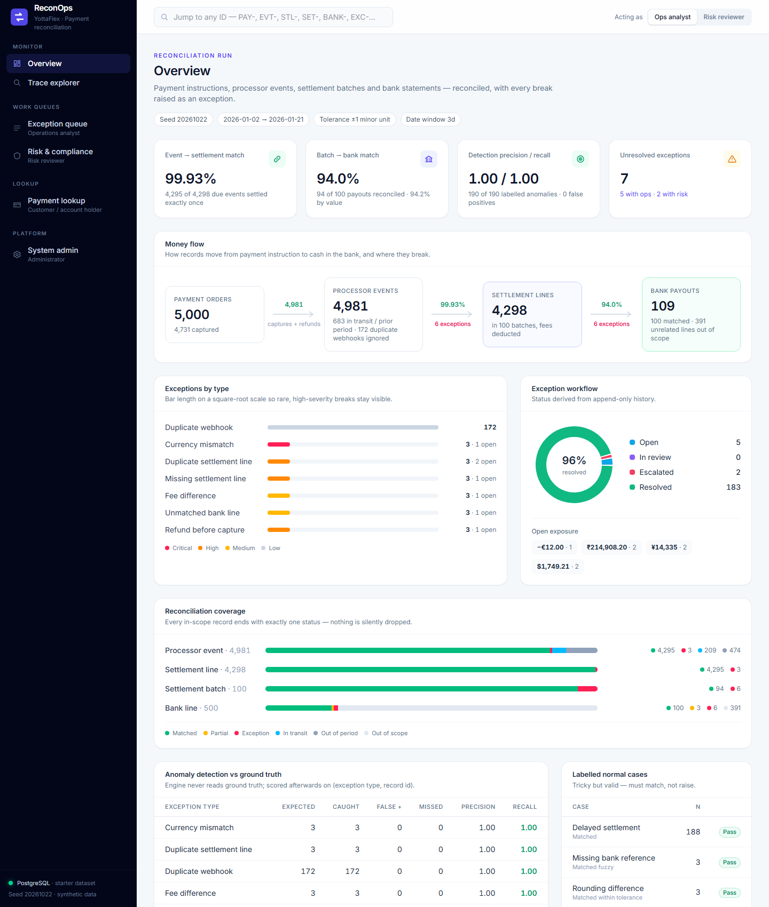
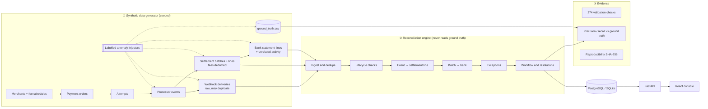
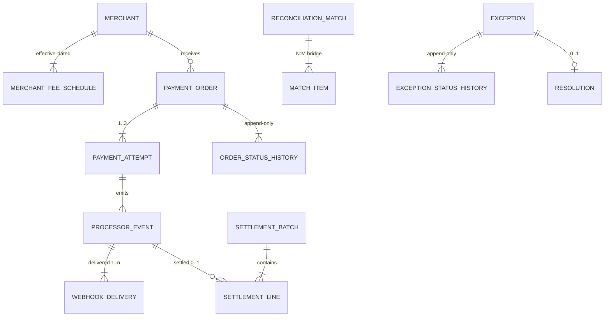
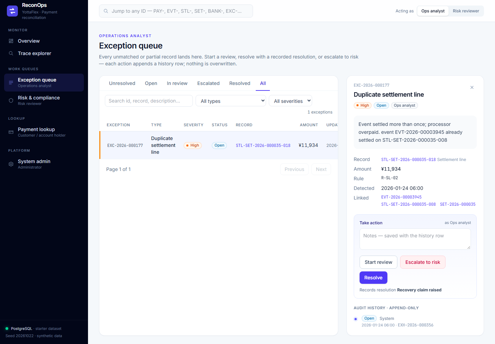
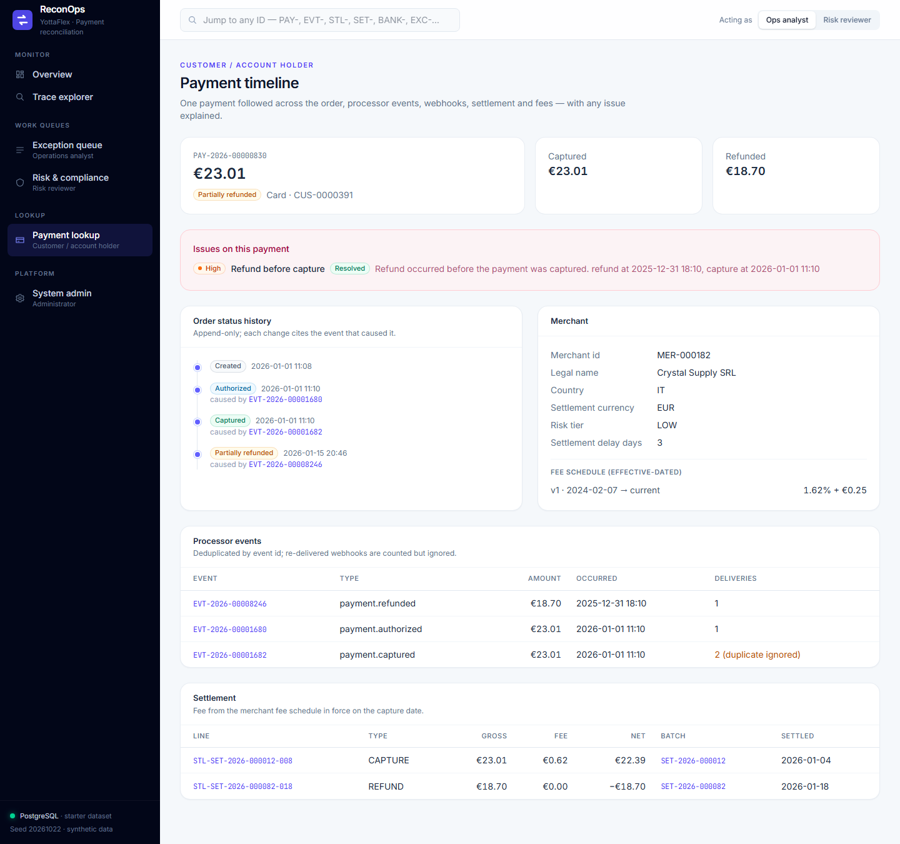
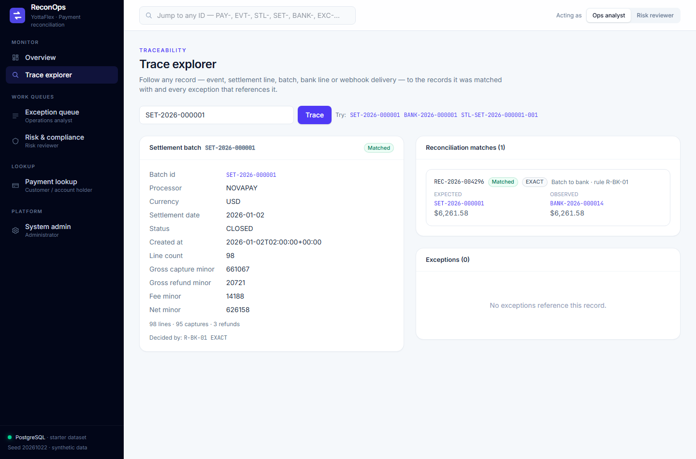
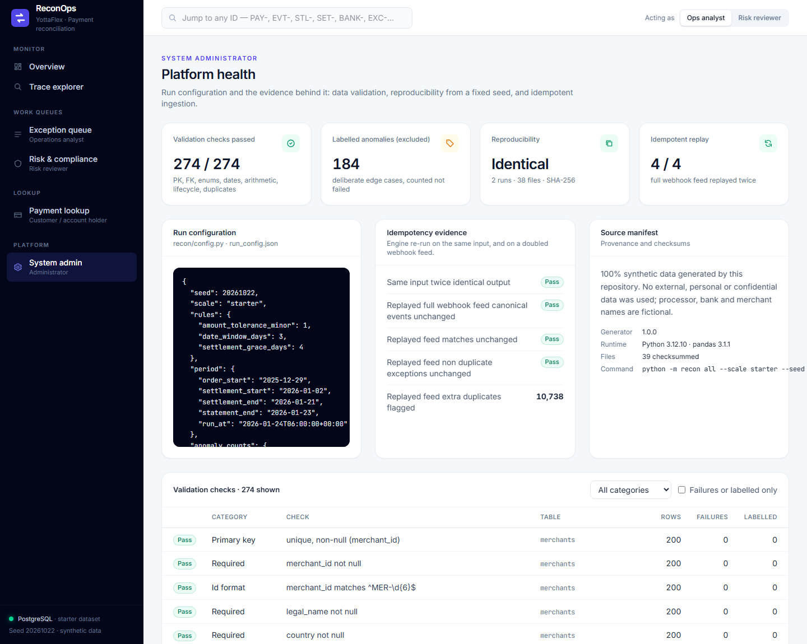

<div align="center">

# YottaFlex ReconOps

**End-to-end payment reconciliation: payment instructions → processor events → settlement batches → bank statements.**

Seeded synthetic data · rule-based matching engine · exceptions with append-only audit trail · FastAPI + React operations console


*Submission for the YottaFlex AI Forward Deployed Engineer 72-hour code challenge.*



</div>

---

## Results at a glance

Full scale, seed `20261022`. Every number below comes from committed reports in [`data/full/reports/`](data/full/reports/).

| | Result |
|---|---|
| **Volume** | 2,000 merchants · 50,000 payment orders · 55,000 attempts · 1,000 settlement batches · 5,000 bank lines (exactly as specified) |
| **Anomaly detection** | **1,926 / 1,926** labelled anomalies caught · **0 false positives** · **0 missed** → precision **1.00**, recall **1.00** |
| **Tricky-but-valid cases** | 2,006 delayed settlements, 60 split payouts, 24 rounding differences, 35 reference-less payouts: **100% correctly matched**, none raised as exceptions |
| **Reconciliation** | Event → settlement **99.94%** · Batch → bank **96.5%**. The remainder is exactly the injected anomalies, each raised as an exception. |
| **Data validation** | **274 / 274 checks pass**: PK, FK, enums, ID formats, date ordering, arithmetic, lifecycle, effective dating, duplicates, volumes, acceptance rules |
| **Idempotency** | Replaying the **entire** webhook feed a second time leaves canonical events and every match unchanged |
| **Reproducibility** | Generating twice with the same seed gives **identical SHA-256 for all 38 files** |
| **Tests** | **40 passing**: generator, engine, rule boundaries, API workflow, committed-data checksums |

> **Reviewer shortcut:** [`docs/requirements_traceability.md`](docs/requirements_traceability.md) maps **every line of the brief** to the code that implements it and the test or report that proves it.

---

## Contents

- [Quick start](#quick-start)
- [How it works](#how-it-works)
- [The reconciliation engine](#the-reconciliation-engine)
- [Synthetic data](#synthetic-data)
- [Data model](#data-model)
- [Validation, evaluation and reproducibility](#validation-evaluation-and-reproducibility)
- [Operations console](#operations-console)
- [API](#api)
- [PostgreSQL / Neon](#postgresql--neon)
- [Tests](#tests)
- [Design decisions](#design-decisions)
- [Repository layout](#repository-layout)
- [Provenance and lawful use](#provenance-and-lawful-use)

---

## Quick start

**Requirements:** Python 3.10+ and Node 18+ (Node is only needed for the web console).

```bash
git clone https://github.com/anjim999/yottaflex-reconops.git
cd yottaflex-reconops

python -m venv .venv
# Windows: .venv\Scripts\activate      macOS/Linux: source .venv/bin/activate
pip install -r requirements.txt

python -m recon all --scale starter     # generate → reconcile → validate → evaluate → SQL → DB → reproduce (~30 s)
pytest                                  # 40 tests

cd web && npm install && npm run build && cd ..
uvicorn api.main:app --port 8000        # console → http://localhost:8000   ·   API docs → http://localhost:8000/docs
```

You should see:

```text
reconciled: 4392 matches, 190 exceptions
validation: 274 checks, 0 failed
detection: precision 1.0, recall 1.0, f1 1.0
reproducibility: 38 files compared, identical=True
```

For the full 50k-order dataset, run `python -m recon all --scale full` (about 3–4 minutes including the double-generation reproducibility check).

**No need to run anything to review the data.** Both datasets are committed:
- [`data/starter/`](data/starter/) is complete: CSV, JSON, SQL seed, engine outputs and reports.
- [`data/full/`](data/full/) contains every input CSV, the ground truth, the schema, the manifest and all reports. Its bulky derived files are regenerated by the command above.

<details>
<summary><b>All CLI commands</b></summary>

| Command | What it does |
|---|---|
| `python -m recon generate --scale starter\|full --seed 20261022` | Writes input tables, ground truth and run config |
| `python -m recon reconcile` | Runs the engine: matches, exceptions, history, resolutions, item statuses |
| `python -m recon validate` | 274 data-quality and acceptance checks → `reports/validation_summary.{md,csv}`, plus `reports/data_profile.md` |
| `python -m recon evaluate` | Scores the engine against ground truth and checks idempotency → `reports/metrics.{md,json}` |
| `python -m recon sql` | Writes the PostgreSQL/SQLite seed → `sql/seed.sql` (schema in `sql/schema.sql`) |
| `python -m recon load-db` | Loads into PostgreSQL if `DATABASE_URL` is set, otherwise into local SQLite |
| `python -m recon reproduce` | Generates twice with the same seed and compares row counts and SHA-256 per file |
| `python -m recon docs` | Regenerates [`docs/data_dictionary.md`](docs/data_dictionary.md) from the schema |
| `python -m recon all` | Everything above, in order |

Every command takes `--scale starter|full`, `--seed <int>` and `--out <dir>`.

</details>

---

## How it works



**How the money moves:** a customer pays a merchant (`PaymentOrder`), and the processor authorises and captures it (`PaymentAttempt`, `ProcessorEvent`, delivered by webhook). The processor then batches captures and refunds per currency per day, deducts fees (`SettlementBatch` / `SettlementLine`), and pays the net amount into the bank (`BankStatementLine`). Reconciliation proves that every step agrees with the next, and raises an exception wherever one doesn't.

---

## The reconciliation engine

[`recon/engine/`](recon/engine/) runs in four stages. Each decision records the rule that made it.

| Stage | Rule | Outcome |
|---|---|---|
| **1. Ingest** | Deduplicate webhook deliveries by `event_id` and keep the earliest `received_at`. The same id with a different payload is a conflict. | `canonical_events`; `DUPLICATE_WEBHOOK` (auto-resolved) |
| **2. Lifecycle** | Refund before capture, refund without capture, over-refund, orphan events | `REFUND_BEFORE_CAPTURE`, `OVER_REFUND`, … → risk reviewer |
| **3. Event ↔ settlement line** | Match on `event_id`, then verify amount, currency, line type and the **fee from the schedule in force on the capture date**. An unsettled event is classified as *out of period*, *in transit* (still within the grace window) or **missing**. | `EVENT_TO_SETTLEMENT` matches; `MISSING_SETTLEMENT_LINE`, `DUPLICATE_SETTLEMENT_LINE`, `FEE_RULE_VIOLATION` |
| **4. Batch ↔ bank** | Match on **reference + currency + amount (±1 minor unit) + date window (3 days)**. Split payouts are summed (N:M). A credit with no reference is fuzzy-matched on currency, amount and date, **only if exactly one batch fits**. | `BATCH_TO_BANK` matches (EXACT · WITHIN_TOLERANCE · SPLIT · FUZZY · PARTIAL); `FEE_DIFFERENCE`, `CURRENCY_MISMATCH`, `UNMATCHED_BANK_LINE`, … |

**Coverage guarantee.** Every in-scope record ends with exactly one status in `item_status`: `MATCHED`, `PARTIAL`, `EXCEPTION`, `IN_TRANSIT`, `OUT_OF_PERIOD` or `OUT_OF_SCOPE`. A validation check proves that no unmatched record is left without an exception, so nothing is silently dropped.

<details>
<summary><b>Exception catalogue: 19 types, each with severity, owner and default resolution</b></summary>

| Exception | Severity | Owner | Default resolution |
|---|---|---|---|
| `DUPLICATE_WEBHOOK` | Low | System | Auto-deduplicated |
| `WEBHOOK_PAYLOAD_CONFLICT` | High | Ops analyst | Manual review |
| `ORPHAN_EVENT` | High | Ops analyst | Manual review |
| `REFUND_BEFORE_CAPTURE` | High | Risk reviewer | Timestamp investigated |
| `REFUND_WITHOUT_CAPTURE` / `OVER_REFUND` | Critical | Risk reviewer | Refund reversal requested |
| `DUPLICATE_SETTLEMENT_LINE` | High | Ops analyst | Recovery claim raised |
| `MISSING_SETTLEMENT_LINE` / `ORPHAN_SETTLEMENT_LINE` / `SETTLEMENT_AMOUNT_MISMATCH` | High | Ops analyst | Processor claim raised |
| `FEE_RULE_VIOLATION` / `FEE_DIFFERENCE` | Medium | Ops analyst | Fee adjustment posted |
| `BATCH_TOTAL_MISMATCH` | High | Ops analyst | Processor claim raised |
| `BANK_AMOUNT_MISMATCH` | High | Ops analyst | Manual review |
| `CURRENCY_MISMATCH` | Critical | Risk reviewer | FX return requested |
| `PAYOUT_OUTSIDE_DATE_WINDOW` | Medium | Ops analyst | Late payout accepted |
| `UNMATCHED_SETTLEMENT_BATCH` | High | Ops analyst | Processor claim raised |
| `UNMATCHED_BANK_LINE` | Medium | Ops analyst | Posted to suspense |
| `AMBIGUOUS_BANK_MATCH` | Medium | Ops analyst | Manual review |

Source: [`recon/engine/catalog.py`](recon/engine/catalog.py).

</details>

### Rules and parameters

All rules and parameters live in [`recon/config.py`](recon/config.py).

| Parameter | Value |
|---|---|
| Amount tolerance | ±1 minor unit, covering currency rounding (JPY has 0 decimals) |
| Bank date window | settlement date → +3 days |
| Settlement grace | expected settlement date + 4 days, after which a missing line becomes an exception |
| Fee policy | Capture fee = `round_half_even(gross × bps / 10 000) + fixed fee`, using the **effective-dated** merchant fee schedule. Refunds carry no fee, and the original fee is not returned. |
| Money | Integer minor units everywhere, never floats |

---

## Synthetic data

### Generation order

Generation follows Steps 1–10 of the brief ([`recon/generate/`](recon/generate/)):

1. **Master data first.** Merchants carry a currency, a risk tier and a settlement delay. **Effective-dated fee schedules** cover about 10% of merchants, who are repriced mid-period: v1 closes the day before v2 starts.
2. **Dependent records.** Every child record uses a valid parent ID:
   - **Orders:** Pareto merchant volume, a weekday/weekend pattern and log-normal basket sizes in 5 currencies.
   - **Attempts:** 10% are retries.
   - **Events:** authorised, captured (15% are delayed manual captures), voided, failed (6 failure codes) and refunded (about 66% of refunds are partial).
3. **Derived values are never random.** Order status, captured and refunded totals, and status history come from events. Batch totals come from lines, and bank payouts come from batch nets.
4. **Settlement.** One batch per currency per day gives 5 × 200 = **1,000 batches**. 4% of items settle 1–3 days late.
5. **Bank.** Payouts arrive 0–2 days after settlement:
   - 8% are split into two credits.
   - 3% are off by 1 minor unit (rounding).
   - 3% have a truncated reference.
   - Vendor, payroll, inbound, charge and interest lines fill the statement to **5,000**.
6. **Labelled anomalies** are then injected into otherwise valid data. Each injector touches only its target rows, and totals are recomputed afterwards.

Distribution evidence is in [`data/full/reports/data_profile.md`](data/full/reports/data_profile.md). For example, the top 10% of merchants carry about 46% of volume, and amount quantiles, retry rates, failure codes, refund mix and settlement lag are all profiled.

### The six required edge cases

| Edge case (brief) | How it is injected | Expected engine decision | Full-scale result |
|---|---|---|---|
| Duplicate settlement line | A capture line is copied into the same batch under a new line number | `DUPLICATE_SETTLEMENT_LINE` on the copy | 30 / 30 |
| Bank amount differs by fee | The bank credits the gross amount before fees, or deducts a wire fee | Partial match + `FEE_DIFFERENCE` | 20 / 20 |
| Refund appears before capture | The refund timestamp is moved before the capture | `REFUND_BEFORE_CAPTURE` → risk | 30 / 30 |
| Unmatched record silently dropped | A capture is removed from the settlement file, **and** a processor credit arrives with no batch | `MISSING_SETTLEMENT_LINE` / `UNMATCHED_BANK_LINE` | 30 / 30 · 10 / 10 |
| Currency mismatch | The payout is booked in the wrong currency | `CURRENCY_MISMATCH`, never auto-matched | 15 / 15 |
| Same processor event ingested twice | The webhook is re-delivered 1–2 extra times | Idempotent dedupe + `DUPLICATE_WEBHOOK` | 1,791 / 1,791 |

**Labelled normal cases.** `DELAYED_SETTLEMENT`, `ROUNDING_DIFFERENCE`, `SPLIT_PAYOUT` and `MISSING_BANK_REFERENCE` are labelled too, so the engine is also scored on what it **must not** flag.

**Ground truth is separate.** It lives only in `ground_truth/ground_truth.{csv,json}`. The engine's loader never reads it, and a test asserts that no label column appears in any input table.

### ID conventions

IDs are zero-padded, assigned chronologically, immutable and never renumbered.

| Entity | Format |
|---|---|
| PaymentOrder | `PAY-2026-00000001` |
| PaymentAttempt | `ATT-PAY-2026-00000001-01` |
| SettlementBatch | `SET-2026-000001` |
| SettlementLine | `STL-SET-2026-000001-001` |
| BankStatementLine | `BANK-2026-000001` |
| ReconciliationMatch | `REC-2026-000001` |
| Merchant · Fee schedule · Event · Delivery · Exception · Resolution | `MER-000001` · `FEE-000001` · `EVT-2026-00000001` · `DLV-2026-00000001` · `EXC-2026-000001` · `RES-2026-000001` |

---

## Data model



- **Every entity has a primary key, and every relationship has a foreign key.** These are enforced as real `PRIMARY KEY`, `FOREIGN KEY` and `CHECK` constraints in [`sql/schema.sql`](data/starter/sql/schema.sql), with 20 FKs and 45 CHECKs in PostgreSQL.
- **N:M relationships use a bridge table.** `match_items` links a match to the records on each side, for example one batch to two split bank credits.
- **History is never overwritten.** `order_status_history` and `exception_status_history` are insert-only, and current status is always derived from the latest row.
- **Documentation:**
  - [`docs/erd.md`](docs/erd.md) covers the full ERD, cardinality, optional relationships, lifecycle states and effective dating.
  - [`docs/data_dictionary.md`](docs/data_dictionary.md) gives type, required, allowed values, unit, uniqueness and validation rule for every field. It is generated from [`recon/schema.py`](recon/schema.py), so it cannot drift from the code.

---

## Validation, evaluation and reproducibility

| Evidence | Where |
|---|---|
| **274 validation checks**: PK (17), FK incl. polymorphic (24), required (134), enums (45), ID regex (17), date ordering (6), arithmetic (5), lifecycle (6), effective dating (4), duplicates (2), consistency (2), volume (5), acceptance (6) | [`reports/validation_summary.md`](data/full/reports/validation_summary.md) |
| **Precision / recall per exception type**, plus decision accuracy on labelled normal cases | [`reports/metrics.md`](data/full/reports/metrics.md) |
| **Distribution profile** (realism) | [`reports/data_profile.md`](data/full/reports/data_profile.md) |
| **Reproducibility**: two runs, row counts and SHA-256 per file | [`reports/reproducibility_report.json`](data/full/reports/reproducibility_report.json) |
| **Source manifest**: generator version, seed, command, library versions, SHA-256 of every file | [`manifest.json`](data/full/manifest.json) |

Deliberately injected anomalies (1,894 at full scale) are **counted separately as "labelled"**, so the report shows **0 unlabelled violations** while still accounting for every planted defect.

### Acceptance criteria

| Criterion | Proof |
|---|---|
| Matched amounts reconcile under the configured tolerance | 0 `MATCHED` rows with \|difference\| > 1 minor unit |
| Every unmatched item is an exception | `item_status` coverage; every `PARTIAL` match has an exception; every settlement line is matched or an exception |
| Duplicate events are idempotent | The full webhook feed replayed twice leaves canonical events and matches unchanged |
| Fee and refund treatment is consistent | Every line fee is recomputed from the effective-dated schedule (0 violations); refund fee is always 0 |

---

## Operations console

FastAPI ([`api/`](api/)) serves a REST API over the reconciled database and the built React app ([`web/`](web/), React + TypeScript + Vite + Tailwind). Use the switch at the top right to act as an **Ops analyst** or a **Risk reviewer**.

| Actor | Page | What they can do |
|---|---|---|
| **Operations analyst** | Exception queue | Filter by status, type and severity. Open an exception to see linked records and its audit timeline. **Start review → Resolve**, or **Escalate to risk**, with notes. |
| **Risk / compliance reviewer** | Risk & compliance | Work the risk-owned queue. Read the immutable audit trail (who, what, when) and the financial adjustments. |
| **Customer / account holder** | Payment lookup | See one payment end to end: status history, deduplicated events and delivery count, settlement and fees, the fee schedule, and any issues explained. |
| **System administrator** | System admin | Run config, all 274 validation checks, reproducibility and idempotency evidence, and the source manifest. |
| Everyone | Overview · Trace explorer | KPIs and the money-flow pipeline. Trace any ID (`EVT-`, `STL-`, `SET-`, `BANK-`, `DLV-`) to its matches and exceptions. |

| Exception queue: append-only workflow | Payment timeline |
|---|---|
|  |  |
| **Trace explorer** | **System admin** |
|  |  |

**Workflow guarantees** are enforced by the API and covered by tests:
- Actions only **INSERT** into `exception_status_history` and `resolutions`. Nothing is updated in place.
- Illegal transitions are rejected with **409**, for example resolving an exception that is already resolved.
- **Segregation of duties.** Risk-owned exceptions can only be resolved by a `RISK_REVIEWER`; anyone else gets **403**. Only an analyst can start a review or escalate.
- New IDs continue the immutable counters (`EXH-…`, `RES-…`).

For frontend development with hot reload, run `uvicorn api.main:app --reload --port 8000` and `cd web && npm run dev`, then open http://localhost:5173. Vite proxies `/api` to FastAPI.

---

## API

Interactive docs are served at **`/docs`**.

| Endpoint | Purpose |
|---|---|
| `GET /api/health` | Backend (postgres / sqlite) and dataset |
| `GET /api/summary` | Counts, money flow, coverage, live exception stats, metrics, run config |
| `GET /api/exceptions?status=&type=&severity=&owner=&q=&limit=&offset=` | Exception queue; status is derived from history |
| `GET /api/exceptions/{id}` | Detail, audit history, resolution and allowed actions |
| `POST /api/exceptions/{id}/actions` | `{"action": "START_REVIEW" \| "ESCALATE" \| "RESOLVE", "actor_role": "OPS_ANALYST" \| "RISK_REVIEWER", "notes": "…"}` |
| `GET /api/payments?q=` · `GET /api/payments/{id}` | Payment search and full timeline |
| `GET /api/trace/{id}` | Record, matches, counterpart records and exceptions |
| `GET /api/validation` · `/api/audit` · `/api/resolutions` | Admin and compliance evidence |

---

## PostgreSQL / Neon

```bash
cp .env.example .env            # set DATABASE_URL=postgresql://…neon.tech/db?sslmode=require
python -m recon load-db --scale starter
uvicorn api.main:app --port 8000
```

- **With `DATABASE_URL` set**, the loader drops and recreates the schema in PostgreSQL and bulk-loads with `COPY`. The API then reads and writes PostgreSQL through a connection pool, running each page's independent queries in parallel, so pages load in under a second even against a remote region.
- **Without `DATABASE_URL`**, the same DDL loads into a local SQLite file, and `PRAGMA foreign_key_check` must pass.
- **Credentials** are only ever read from `.env`, which is git-ignored.

---

## Tests

```bash
pytest -v      # 40 tests, ~20 s
```

| File | Covers |
|---|---|
| `test_generator.py` | ID formats from the brief, volumes, FK integrity, derived batch totals, baseline variety, all 6 edge cases labelled, no ground-truth leakage, same-seed reproducibility, effective-dated fees, committed-manifest checksums |
| `test_engine.py` | 100% precision and recall, correct decisions on normal cases, tolerance, every unmatched item an exception, idempotent replay, determinism, fee consistency, append-only history, traceability |
| `test_rules.py` | Boundary tests: exact vs ±1 (match) vs ±2 (exception), fee difference, currency mismatch never auto-matched, date window, fuzzy match, unknown credit, webhook dedupe and payload conflict |
| `test_api.py` | Health, summary, filters and paging, append-only workflow, 409 on illegal transition, 403 segregation of duties, payment timeline, trace, unknown IDs. Runs on a throwaway SQLite copy and never touches a real database. |

---

## Design decisions

| Decision | Why |
|---|---|
| **Deterministic rules, not ML, for matching** | Reconciliation decisions must be explainable and auditable. Every match and exception carries a `rule_id`. Precision 1.00 / recall 1.00 at zero false positives is the bar for a finance control. |
| **Integer minor units** | No floating-point drift; JPY (0 decimals) is handled natively; tolerance is defined in minor units. |
| **Fuzzy matching only on a unique candidate** | A wrong auto-match is worse than an exception. Ambiguity becomes `AMBIGUOUS_BANK_MATCH` for a human. |
| **Ground truth generated by the injectors themselves** | Labels come from documented rules, not random assignment, and live in a separate folder the engine never reads. |
| **Append-only history; status derived** | Satisfies "do not overwrite history" and gives a complete audit trail for risk and compliance. |
| **One schema definition drives DDL, docs and validation** | [`recon/schema.py`](recon/schema.py) generates `schema.sql`, the data dictionary and the validation rules, so they can never disagree. |
| **Same generator for starter and full** | `--scale` only changes volumes, and anomaly counts scale with it, so a 30-second run exercises every path. |
| **Explicit "in transit" and "out of period" states** | Timing differences are not errors. Only items past the grace window become exceptions, which is why there are zero false positives. |

---

## Repository layout

```text
recon/
  config.py              seed, scales, rules, distributions: single source of truth
  ids.py  money.py  fees.py   ID formats, minor-unit fee arithmetic, effective-dated fee lookup
  schema.py              every table and field → SQL DDL, data dictionary, validation rules
  generate/              merchants · orders · events · status · settlement · bank · anomalies · deliveries · pipeline
  engine/                ingest · lifecycle · match_lines · match_bank · resolve · ledger · catalog · run
  validate.py            PK / FK / enum / date / arithmetic / lifecycle / duplicate / acceptance checks
  metrics.py  profile.py precision & recall vs ground truth, KPIs, distribution profile
  export.py  db.py       CSV / JSON / SQL writers, checksummed manifest, PostgreSQL / SQLite loader
  cli.py                 python -m recon …
api/                     FastAPI: db.py (pooled Postgres / SQLite), routes/ (overview, exceptions, payments, trace)
web/                     React + TypeScript + Vite + Tailwind: pages/ (6 views), components/, lib/
tests/                   generator, engine, rule-boundary, API tests
docs/                    requirements_traceability.md · data_dictionary.md · erd.md · screenshots/
data/
  starter/               input/ output/ ground_truth/ sql/ reports/ manifest.json run_config.json
  full/                  input/ ground_truth/ sql/schema.sql reports/ manifest.json run_config.json
```

---

## Provenance and lawful use

All data is **100% synthetic**, generated by [`recon/generate/`](recon/generate/) from seed `20261022`. No external dataset was used, so there are no licences to record and no fields were discarded. Customer identifiers are pseudonymous (`CUS-…`) and contain no personal data. All names, including the processor *NOVAPAY*, the bank *FIRST LEDGER BANK* and every merchant, are invented. Each `manifest.json` records the generator version, seed, exact command, library versions and the SHA-256 of every file.
