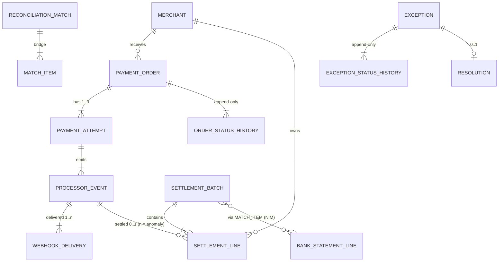

# Entity relationship model

## Cardinality and optionality

| Relationship | Cardinality | Notes |
|---|---|---|
| Merchant -> PaymentOrder | 1 : N | order currency = merchant settlement currency |
| PaymentOrder -> PaymentAttempt | 1 : 1..3 | retries after a failed attempt; ~10% of orders |
| PaymentOrder -> OrderStatusHistory | 1 : N | append-only; `payment_orders.status` = latest row |
| PaymentAttempt -> ProcessorEvent | 1 : N | failed -> `payment.failed`; success -> authorized, captured/voided, refunded |
| ProcessorEvent -> WebhookDelivery | 1 : 1..n | n > 1 = duplicate webhook (labelled) |
| ProcessorEvent -> SettlementLine | 1 : 0..1 | 0 = in transit / prior period / **dropped** (labelled); 2 = duplicate line (labelled) |
| SettlementBatch -> SettlementLine | 1 : N | one batch per currency per settlement date; max 999 lines |
| SettlementBatch <-> BankStatementLine | N : M | usually 1:1; split payouts are 1:2; resolved through `match_items` bridge |
| ReconciliationMatch -> MatchItem | 1 : N | LEFT side (event / batch) and RIGHT side (line / bank lines) |
| Exception -> polymorphic entity | N : 1 | `entity_type` + `entity_id`; validated in `validate.py` |
| Exception -> ExceptionStatusHistory | 1 : N | OPEN -> IN_REVIEW / ESCALATED -> RESOLVED |
| Exception -> Resolution | 1 : 0..1 | exists iff exception status is RESOLVED |

## Lifecycle states

- **PaymentOrder**: `CREATED -> AUTHORIZED -> CAPTURED -> PARTIALLY_REFUNDED -> REFUNDED`; `CREATED -> FAILED`; `AUTHORIZED -> VOIDED`.
- **PaymentAttempt**: `SUCCEEDED` | `FAILED` (with `failure_code`).
- **SettlementBatch**: `CLOSED`; reconciliation state lives in `item_status` (`MATCHED`, `PARTIAL`, `EXCEPTION`, `IN_TRANSIT`).
- **Exception**: `OPEN -> IN_REVIEW -> RESOLVED`, `OPEN -> ESCALATED -> RESOLVED` (risk-owned types).

## Effective dates

`merchants.effective_from` / `effective_to` scope each merchant's fee terms (`fee_rate_bps`, `fixed_fee_minor`, `settlement_delay_days`).
`effective_to = NULL` means current. History is never overwritten: state changes are new rows in the `*_status_history` tables.
